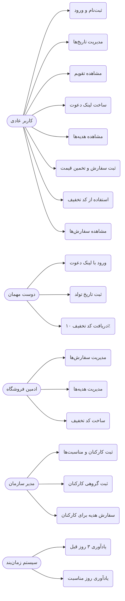
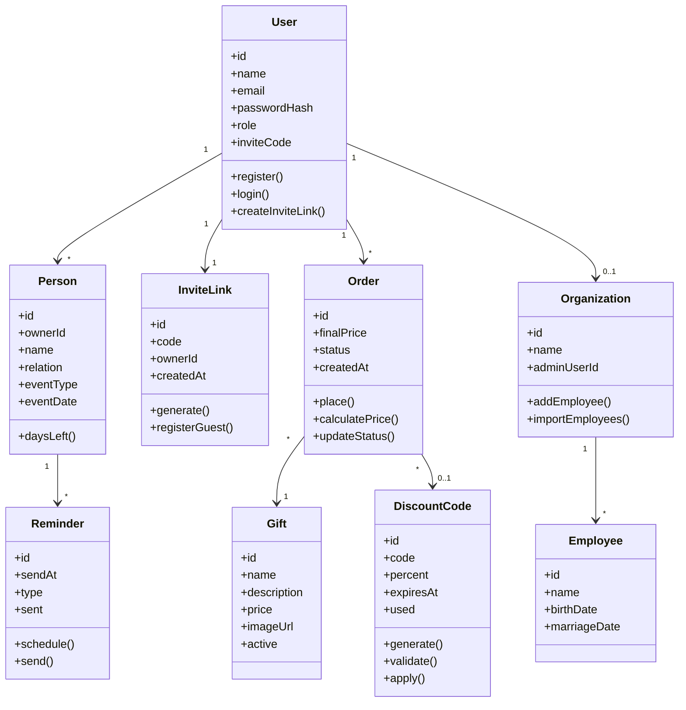
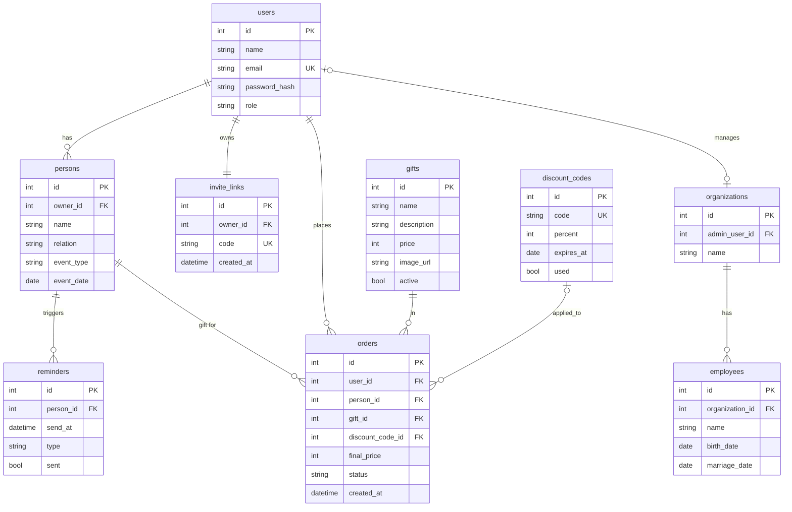

# سند نیازمندی‌ها و طراحی

## اپلیکیشن هوشمند تقویم مناسبت‌ها و سفارش هدیه (Smart Gift Calendar)

- درس: مهندسی نرم‌افزار
- پلتفرم: اندروید
- مخزن: github.com/smart-gift-calendar/smart-gift-calendar

---

## ۱. مقدمه

### ۱.۱ هدف

اپلیکیشن به کاربر کمک می‌کند تاریخ تولد و مناسبت‌های اعضای خانواده و دوستان را ثبت کند، پیش از هر مناسبت یادآوری بگیرد و همان لحظه برای آن فرد هدیه سفارش دهد. فروشگاه (ادمین) و شرکت‌ها هم پنل مدیریتی مخصوص خود را دارند.

### ۱.۲ دامنه

شامل: ثبت‌نام و ورود، تقویم شخصی، لینک دعوت اختصاصی، یادآوری، فروشگاه ساده، کد تخفیف، پنل ادمین و پنل سازمان‌ها.

خارج از دامنه: درگاه پرداخت واقعی، ارسال فیزیکی و رهگیری مرسوله.

### ۱.۳ نقش‌ها (Actors)

| نقش | توضیح |
|---|---|
| کاربر عادی | تاریخ‌ها را ثبت می‌کند، یادآوری می‌گیرد و هدیه سفارش می‌دهد |
| دوست مهمان | از طریق لینک دعوت، تاریخ تولد خود را ثبت می‌کند |
| ادمین فروشگاه | سفارش‌ها، هدیه‌ها و کدهای تخفیف را مدیریت می‌کند |
| مدیر سازمان | تاریخ‌های کارکنان را ثبت و برای آن‌ها هدیه سفارش می‌دهد |
| سیستم (زمان‌بند) | یادآوری‌ها را خودکار ارسال می‌کند |

---

## ۲. نیازمندی‌های عملکردی (Functional)

### ۲.۱ بخش کاربری

- **FR-01:** کاربر می‌تواند ثبت‌نام کند و وارد حساب شود.
- **FR-02:** کاربر می‌تواند تاریخ تولد خود، اعضای خانواده و دوستان را ثبت، ویرایش و حذف کند.
- **FR-03:** سیستم تقویمی نشان می‌دهد که مناسبت‌های پیش‌رو کدام‌اند و به ترتیب نزدیکی مرتب می‌شوند.
- **FR-04:** هر کاربر یک لینک دعوت اختصاصی دارد و می‌تواند آن را برای دوستان بفرستد.
- **FR-05:** دوست مهمان از طریق لینک، نام و تاریخ تولد خود را ثبت می‌کند و در تقویم صاحب لینک اضافه می‌شود.

### ۲.۲ بخش یادآوری

- **FR-06:** سیستم ۳ روز قبل از هر مناسبت پیام یادآوری می‌فرستد، مثلاً «تولد علی سه روز دیگر است، می‌خواهی برایش هدیه سفارش بدهی؟»
- **FR-07:** سیستم در خود روز مناسبت هم یادآوری می‌فرستد.
- **FR-08:** پیام یادآوری دکمه‌ای دارد که کاربر را مستقیم به صفحه هدیه‌ها می‌برد.

### ۲.۳ بخش فروشگاه

- **FR-09:** کاربر لیست هدیه‌ها را با عکس، توضیح و قیمت می‌بیند.
- **FR-10:** کاربر هدیه را انتخاب و سفارش ثبت می‌کند و تخمین قیمت (قیمت کل پس از تخفیف) را می‌بیند.
- **FR-11:** اگر کاربر از طریق لینک دوستش وارد شده باشد، یک کد تخفیف ۱۰٪ دریافت می‌کند.
- **FR-12:** کاربر می‌تواند کد تخفیف را هنگام ثبت سفارش وارد کند.
- **FR-13:** کاربر می‌تواند سفارش‌های قبلی و وضعیت آن‌ها را ببیند.

### ۲.۴ پنل ادمین

- **FR-14:** ادمین فهرست همه سفارش‌ها را می‌بیند و وضعیت هر سفارش را تغییر می‌دهد (ثبت‌شده، در حال آماده‌سازی، ارسال‌شده، تحویل‌شده).
- **FR-15:** ادمین هدیه جدید اضافه، ویرایش و حذف می‌کند.
- **FR-16:** ادمین کد تخفیف با درصد و تاریخ انقضا می‌سازد.

### ۲.۵ پنل سازمان‌ها

- **FR-17:** مدیر سازمان حساب سازمانی می‌سازد.
- **FR-18:** مدیر سازمان کارکنان را با تاریخ تولد و تاریخ ازدواج (و مناسبت‌های دیگر) وارد می‌کند، به صورت تکی یا گروهی.
- **FR-19:** مدیر سازمان برای هر کارمند هدیه سفارش می‌دهد و یادآوری مناسبت‌ها را دریافت می‌کند.

---

## ۳. نیازمندی‌های غیرعملکردی (Non-functional)

| کد | دسته | توضیح |
|---|---|---|
| NFR-01 | کارایی | بارگذاری هر صفحه کمتر از ۳ ثانیه |
| NFR-02 | امنیت | رمز عبور به صورت هش ذخیره شود و دسترسی هر نقش جدا باشد |
| NFR-03 | حریم خصوصی | تاریخ تولد افراد فقط برای صاحب تقویم و ادمین‌های مجاز دیده شود |
| NFR-04 | قابلیت استفاده | رابط فارسی، راست‌به‌چپ و ساده |
| NFR-05 | قابلیت اطمینان | یادآوری‌ها حتی اگر برنامه بسته باشد ارسال شوند |
| NFR-06 | سازگاری | پشتیبانی از اندروید ۸ به بالا |
| NFR-07 | تقویم | پشتیبانی از تقویم شمسی و میلادی |

---

## ۴. نمودار موارد کاربرد (Use Case)

### ۴.۱ فهرست موارد کاربرد به تفکیک نقش

| نقش | موارد کاربرد |
|---|---|
| کاربر عادی | ثبت‌نام و ورود، مدیریت تاریخ‌ها، مشاهده تقویم، ساخت لینک دعوت، مشاهده هدیه‌ها، ثبت سفارش و تخمین قیمت، استفاده از کد تخفیف، مشاهده سفارش‌ها |
| دوست مهمان | ورود با لینک دعوت، ثبت تاریخ تولد، دریافت کد تخفیف ۱۰٪ |
| ادمین فروشگاه | مدیریت سفارش‌ها، مدیریت هدیه‌ها، ساخت کد تخفیف |
| مدیر سازمان | ثبت کارکنان و مناسبت‌ها، ثبت گروهی کارکنان، سفارش هدیه برای کارکنان |
| سیستم (زمان‌بند) | ارسال یادآوری ۳ روز قبل، ارسال یادآوری روز مناسبت |

### ۴.۲ شرح چند مورد کاربرد کلیدی

**UC-01: ثبت سفارش هدیه**

- بازیگر: کاربر عادی
- پیش‌شرط: کاربر وارد حساب شده است.
- جریان اصلی:
  1. کاربر صفحه هدیه‌ها را باز می‌کند.
  2. هدیه را انتخاب می‌کند.
  3. فرد مقصد (از تقویم) را برمی‌گزیند.
  4. در صورت داشتن کد تخفیف آن را وارد می‌کند.
  5. سیستم قیمت نهایی را نشان می‌دهد.
  6. کاربر سفارش را تأیید می‌کند.
  7. سیستم سفارش را با وضعیت «ثبت‌شده» ذخیره می‌کند.
- جریان جایگزین: کد تخفیف نامعتبر یا منقضی باشد، سیستم پیام خطا می‌دهد و قیمت بدون تخفیف می‌ماند.
- پس‌شرط: سفارش در پنل ادمین دیده می‌شود.

**UC-02: ثبت تولد از طریق لینک دعوت**

- بازیگر: دوست مهمان
- جریان اصلی:
  1. دوست لینک را باز می‌کند.
  2. نام و تاریخ تولد خود را وارد می‌کند.
  3. سیستم او را به تقویم صاحب لینک اضافه می‌کند.
  4. سیستم یک کد تخفیف ۱۰٪ برای دوست می‌سازد و نشان می‌دهد.
- پس‌شرط: تولد دوست در تقویم صاحب لینک دیده می‌شود.

**UC-03: ارسال یادآوری**

- بازیگر: سیستم
- جریان اصلی:
  1. زمان‌بند هر روز مناسبت‌های ۳ روز آینده و امروز را پیدا می‌کند.
  2. برای صاحب تقویم نوتیفیکیشن می‌فرستد.
  3. کاربر با لمس پیام به صفحه هدیه‌ها می‌رود.

---

## ۵. نمودار کلاس (Class Diagram)

### ۵.۱ کلاس‌ها و ویژگی‌ها

| کلاس | ویژگی‌ها | متدها |
|---|---|---|
| User | id, name, email, passwordHash, role, inviteCode | register(), login(), createInviteLink() |
| Person | id, ownerId, name, relation, eventType, eventDate | add(), edit(), remove(), daysLeft() |
| InviteLink | id, code, ownerId, createdAt | generate(), registerGuest() |
| Gift | id, name, description, price, imageUrl, active | create(), update(), delete() |
| Order | id, userId, personId, giftId, discountCodeId, finalPrice, status, createdAt | place(), calculatePrice(), updateStatus() |
| DiscountCode | id, code, percent, expiresAt, ownerId, used | generate(), validate(), apply() |
| Reminder | id, personId, sendAt, type (3days/sameDay), sent | schedule(), send() |
| Organization | id, name, adminUserId | addEmployee(), importEmployees() |
| Employee | id, organizationId, name, birthDate, marriageDate | add(), edit(), remove() |

### ۵.۲ روابط

- User ۱ به * Person
- User ۱ به ۱ InviteLink
- User ۱ به * Order
- Order * به ۱ Gift
- Order * به ۰..۱ DiscountCode
- Person ۱ به * Reminder
- Organization ۱ به * Employee
- User ۱ به ۰..۱ Organization (برای نقش مدیر سازمان)
- ادمین نقشی از User است (تفاوت فقط در role و دسترسی)

---

## ۶. نمودار موجودیت-رابطه (ER)

### ۶.۱ جدول‌ها و کلیدها

| جدول | کلید اصلی | کلید خارجی | فیلدهای مهم |
|---|---|---|---|
| users | id | - | name, email (یکتا), password_hash, role |
| persons | id | owner_id → users.id | name, relation, event_type, event_date |
| invite_links | id | owner_id → users.id | code (یکتا), created_at |
| gifts | id | - | name, description, price, image_url, active |
| discount_codes | id | owner_id → users.id (اختیاری) | code (یکتا), percent, expires_at, used |
| orders | id | user_id → users.id، person_id → persons.id، gift_id → gifts.id، discount_code_id → discount_codes.id (اختیاری) | final_price, status, created_at |
| reminders | id | person_id → persons.id | send_at, type, sent |
| organizations | id | admin_user_id → users.id | name |
| employees | id | organization_id → organizations.id | name, birth_date, marriage_date |

### ۶.۲ کاردینالیتی روابط

- users ۱ به N persons
- users ۱ به ۱ invite_links
- users ۱ به N orders
- persons ۱ به N orders
- gifts ۱ به N orders
- discount_codes ۱ به N orders (کد تخفیف در سفارش اختیاری است)
- persons ۱ به N reminders
- organizations ۱ به N employees

---

## ۷. معماری پیشنهادی

- اپ: Kotlin و Jetpack Compose، الگوی MVVM
- بک‌اند: Firebase (Authentication، Firestore، Cloud Messaging) برای حذف نیاز به سرور جدا
- لینک دعوت: Deep Link / App Link همراه با کد دعوت
- یادآوری: WorkManager روی دستگاه یا Cloud Functions زمان‌بندی‌شده

---

## ۸. برنامه تحویل (مراحل)

1. مخزن Git، README و این سند
2. ثبت‌نام و ورود
3. ثبت تاریخ‌ها و تقویم
4. لینک دعوت
5. یادآوری‌ها
6. فروشگاه و سفارش
7. کد تخفیف
8. پنل ادمین
9. پنل سازمان‌ها
10. تست و مستندسازی نهایی
